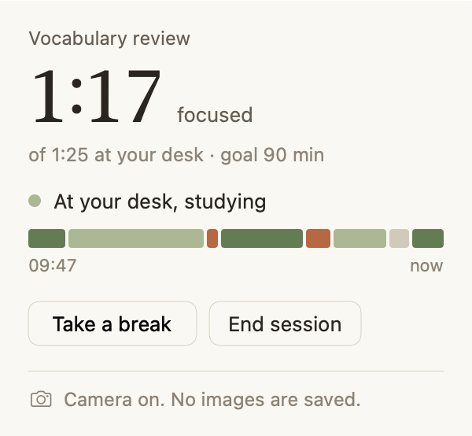
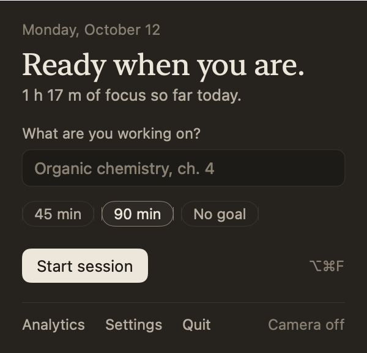
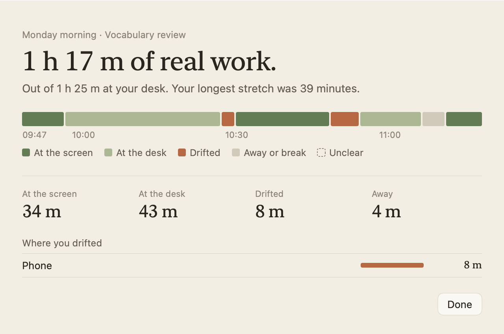
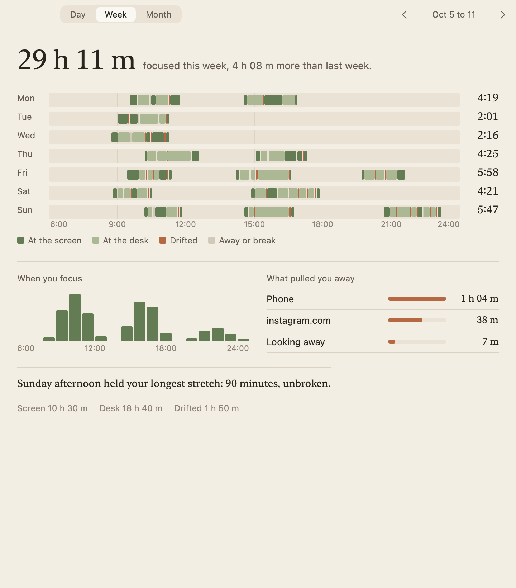

<p align="center"></p>

# Folio

A quiet macOS menu bar app that counts the time you actually study. It
watches where you're looking, notices a phone in your hands or a social site
in front of you, and keeps an honest tally. Reading a textbook counts.
Staring at the wall doesn't. When it can't tell, it says so and asks you at
the end of the session instead of guessing.

Everything stays on your Mac: no account, no network, no images saved.

<p align="center">
  
  
</p>
<p align="center">
  
</p>

## Install

Folio needs macOS 15 or later on Apple silicon.

```bash
brew install --cask hong-iron/tap/folio
```

Or download `Folio-<version>.dmg` from
[Releases](https://github.com/Hong-Iron/folio/releases), open it, and drag
Folio to Applications.

**First launch:** Folio isn't notarized by Apple (that needs a paid
developer account), so macOS will say it can't verify it. Open **System
Settings → Privacy & Security**, scroll down, and click **Open Anyway** next
to Folio. You only do this once.

Folio lives in the menu bar (the little book). Setup takes about two minutes:
camera, your face, how you sit when you study, and permissions.

## What it does

* **Knows it's you.** Your face is enrolled once and checked at the start of
  a session, when you come back, and every couple of minutes. Time with
  someone else in the chair doesn't count.
* **Tells studying from drifting.** Looking at the screen with a focus app
  in front counts. So does looking down at a book or notes, when there's
  evidence of study: a book in view, a writing hand, the small head
  movements of reading. A phone in your hands, a social site, closed eyes
  or a long stare elsewhere don't count.
* **Nudges gently.** After about 30 seconds of drifting, a small note
  appears in the corner. It never blocks anything.
* **Shows you the week.** One ledger strip per day, when you focus best, and
  what pulls you away.

| Looking at | Also seen | Counts as |
|---|---|---|
| Screen | Focus or neutral app, input in the last 90s | Focus |
| Screen | Social site or app in front for 15s or more | Drift |
| Desk | Book, writing, or small reading head motion | Focus |
| Desk | Phone in hand for 20s or more | Drift |
| Desk | Eyes closed 8s or more | Drift (dozing) |
| Desk | Very still, no study evidence for 3+ min | Unclear: you're asked |
| Elsewhere | More than 45s | Drift (zoned out) |
| Nobody, or not you | More than 10s | Away |

<p align="center">
  
</p>

## Privacy

* **Camera** (required): frames are analyzed in memory and dropped. Your
  face is stored as 128 numbers, never as a photo.
* **Accessibility** (recommended): reads the front window's title.
* **Automation, per browser** (optional): asks Safari or Chrome-family
  browsers for the address of the tab in front, only when the title changes.
  Firefox falls back to the window title.

During a session Folio keeps the Mac from idle-sleeping (the display can
still turn off), since you may be reading without touching it. Closing the
lid sleeps the Mac and pauses the session.

Your data lives in `~/Library/Application Support/Folio`. Settings → Your
data exports it as CSV or deletes it.

## How it works

```
Swift shell (sensing)          Rust core (nd-core)              Swift shell (UI)
camera → Vision cascade   ─┐   features → classify → smooth  ┌─ menu bar clock
front app / tab / idle    ─┼─▶ → session clock → SQLite     ─┼─ nudge note
face embedding (SFace)    ─┘   identity, rules, analytics    └─ summary, analytics
```

* **Swift** (`app/Sources`) only measures and draws. The camera runs at its
  lowest format and frame rate, and Vision requests run only when the
  engine's sensing plan asks for them: face pose every second, hands and
  objects every 2s at the desk and every 10s otherwise, identity at start
  and every 2 minutes. Between sessions the camera is off and nothing ticks.
* **Rust** (`core/nd-core`) makes every decision, so the logic is testable
  without a camera. It covers:
  * gaze zones from your calibrated screen and desk poses
  * a first-match classifier
  * a smoother that backdates state changes to when they really started
  * the session clock, nudges, storage and reports
  * face alignment and SFace inference via [tract](https://github.com/sonos/tract)

The app is one executable with the Rust core statically linked; it depends
only on system frameworks.

## Accuracy

Accuracy is measured, not promised. `cargo test` checks every study scenario
against these targets:

* focus-time error 5% or less
* under 1% of phone or social time counted as focus
* at least 95% per-second agreement on confident time
* no nudges during real focus

To measure on your own setup, turn on **Settings → Accuracy lab → Label
mode** and mark what you're really doing with ⌃⌥1 to ⌃⌥6 while you study.
Each session writes a trace (numbers only) next to your data. Then:

```bash
cd core
cargo run -p nd-replay -- run ~/Library/Application\ Support/Folio/Traces/<file>.jsonl
cargo run -p nd-replay -- check ~/Library/Application\ Support/Folio/Traces
```

## Build from source

Needs Xcode 26 or later (for the Icon Composer icon), Rust
(`brew install rustup`, then `rustup default stable`) and XcodeGen
(`brew install xcodegen`).

```bash
./scripts/build-app.sh      # → dist/Folio.app
./scripts/package-dmg.sh    # → dist/Folio-<version>.dmg
```

`./scripts/release.sh <version>` publishes a new version: GitHub release,
DMG, and the Homebrew cask update.

The build downloads the face model (38.7 MB) once and refuses it unless its
SHA-256 matches. `Folio --snapshots <dir>` renders every screen with
synthetic history from a scratch database, in light and dark.

```
core/nd-core        engine, storage, analytics, face model (Rust, UniFFI)
core/nd-replay      replay and accuracy checks for recorded traces
app/Sources         Swift shell: Sensing/, UI/, Support/
app/Resources       AppIcon.icon (Icon Composer)
scripts/            build, package and model scripts
project.yml         XcodeGen project definition
```

## Credits

Face recognition uses [SFace](https://github.com/opencv/opencv_zoo/tree/main/models/face_recognition_sface)
from the OpenCV Model Zoo (Apache-2.0); its license ships inside the app.
Folio itself is MIT licensed.
